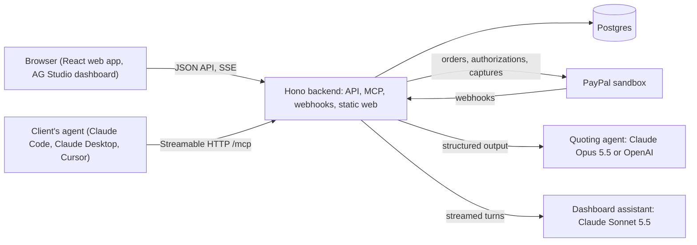

# DealingWith Agent

**Turn service requests into paid work.**

DealingWith Agent lets a service business quote and collect change orders (the extras a client asks for after the contract is signed) with PayPal. The request can come from a person on the web or from the client's own AI agent over MCP. A quoting agent reads it against the contracted scope, a deterministic engine sets the price, and PayPal moves the money, including payments the client's agent makes on its own inside a budget the client authorized once.

Built for the PayPal AI Hackathon (November 2026). Public repository, MIT license.

- **Hosted demo:** https://dealingwith.si (PayPal sandbox, real model calls, nothing to install)
- **Video:** `TBD: video link`
- **Agent endpoint (MCP):** `https://dealingwith.si/mcp`

## The problem

"Can you also add…?" is where freelancers and small service firms lose money. Mid-project, three questions go unanswered:

- **Is this already included?** Nobody rereads the contract, so extras get done for free.
- **What does the extra cost, and why?** Writing a quote for a US$80 change takes longer than the change.
- **Who chases the payment?** Approved work waits on an invoice.

Clients are also starting to send AI agents to buy for them. An agent can check out a fixed-price product from a catalog, but it has no way to ask what a contract covers, get a price it can rely on for custom work, and pay inside limits its owner set.

## The solution

The client asks for one more thing in plain language, on the project page or through their own AI agent. DealingWith Agent then:

1. **Reads the request against the contract.** The quoting agent marks each part as included (US$0.00, citing the contract clause), extra (citing the provider's pricing rule) or unclear (it asks before anything is priced).
2. **Prices the extra without the model.** A deterministic engine computes the amount from the provider's price list.
3. **Collects with PayPal.** A person pays at PayPal checkout. The client's agent pays on its own inside a mandate: a budget with a per-purchase and a total limit that the client authorizes once with PayPal. Outside those limits, the agent gets a link for a person to pay instead.
4. **Updates the contract.** The paid extra becomes a new scope clause (listed as "Paid additionals" on the project page), so asking for it again comes back as included.

A person on the web and an agent over MCP work on the same versioned quote and the same payment.

## Where PayPal and AI do the work

PayPal is not a checkout button here: it is the spending limit itself. The client approves a budget once in PayPal, PayPal holds it, and every purchase the agent makes is a partial capture of that hold, so an agent can never spend money PayPal has not already set aside. The AI decides what a request is, never what it costs.

| Piece | What it does | Code |
|---|---|---|
| PayPal Orders v2 | Pay-now orders (intent `CAPTURE`) and the one-time funding of an agent's budget (intent `AUTHORIZE`) | [`integrations/paypal/sandbox.ts`](apps/backend/src/integrations/paypal/sandbox.ts) |
| PayPal Payments v2 | Each purchase an agent makes is a partial capture of that authorization (`final_capture: false`) | [`workflows/accept-quote.ts`](apps/backend/src/workflows/accept-quote.ts) |
| PayPal Webhooks | Six events, signature-verified with PayPal and applied once per event id | [`workflows/webhooks.ts`](apps/backend/src/workflows/webhooks.ts) |
| Quoting agent | Claude Opus 5.5 (or OpenAI `gpt-6.1-sol`, same prompts) classifies every ask as included, extra or unclear. It returns a structured classification per line, never an amount | [`apps/backend/src/agent/`](apps/backend/src/agent/) |
| MCP server | Nine tools that let the client's agent, in any app that speaks MCP (Claude Code, Claude Desktop, Cursor), request quotes and pay within the mandate | [`apps/backend/src/mcp/`](apps/backend/src/mcp/) |
| Dashboard assistant | Claude Sonnet 5.5 behind the AG Studio Agent Framework, with a custom Collections agent that drafts payment reminders | [`apps/web/src/dashboard/assistant/`](apps/web/src/dashboard/assistant/), [`apps/backend/src/assistant/`](apps/backend/src/assistant/) |

One rule holds everywhere: **the model never prices.** Amounts come from the provider's catalog through the pricing engine, in integer cents, and every line cites the contract clause or the pricing rule behind it.

## Demo accounts

- **Demo logins (no password):** "Try the live demo" on the home page opens the login page; choose "Enter as client (Mara)" or "Enter as provider (Andes Data Studio)".
- **PayPal sandbox buyer account for judges:** email `sb-nyhgp53771637@personal.example.com`, password `Z!_1Jq@$`. This is test data, not a secret; the sandbox never moves real money.

The demo business is Andes Data Studio, a data consultancy. Its client Lukas Retail GmbH (contact Mara Keller) contracted project P1, "Retail KPI dashboard", with three scope clauses:

- **C1, included:** five views, including a per-branch view
- **C2, excluded:** automations, scheduled emails and alerts
- **C3, included:** one data source, Shopify

The project has one agent budget, mandate M1: at most US$100.00 per purchase and US$300.00 in total, until 31 Dec 2026. Every demo run starts with that budget proposed but not assigned: Mara assigns it from the project page and approves once in PayPal, which holds the US$300.00 total and captures only what the agent spends.

## How judges test in two minutes

Sign in as Mara and type the requests into the box labelled "Describe what you need" on the project page. Start from the seeded state, where the project lists three clauses and the agent budget is not assigned; to restore it, sign in as the provider and click "Reset demo data" (inside "Menu" on a narrow window).

Requests 2 and 3 are meant to come from Mara's AI agent. Typed on the web they produce the same quotes, but a person pays with PayPal and the mandate is not used. To watch the agent pay on its own, do two things before request 2:

- **Assign the budget.** In the "Agent budget" panel click "Assign a budget to your agent", keep the proposed limits, click "Continue to PayPal" and approve with the judge account. Back on the project page the panel reads "Active" and "Backed by PayPal authorization", US$300.00 left to capture.
- **Connect an agent** ([Connect your agent](#connect-your-agent)) and send requests 2 and 3 from it.

1. "I need a per-branch view and a summary email every Monday." The quote marks the per-branch view as included at US$0.00 (clause C1) and prices the Monday summary at US$80.00 (rule `S2.report.v1`), delivery 1 day. Click "Pay with PayPal", approve on PayPal's page with the judge account, and PayPal brings you back to a receipt; the project gains clause C4 "Weekly Monday summary email". Total paid: US$80.00.
2. "Add our Amazon sales as a second source, no rush." Sent by Mara's agent over MCP, the quote comes to US$190.00 (US$150.00 base plus US$40.00 for one source). That is over the mandate's US$100.00 per-purchase limit, so Mara's agent gets `approval_required` and an approval link for a human to pay. Leave it unpaid for now: paying it shifts the clause numbers below.
3. "Alert me by email when any branch's daily sales drop more than 20%." Sent by Mara's agent, the US$60.00 alert (rule `S2.alert.v1`) is within the mandate: the agent's `accept_quote` returns `paid`, PayPal captures US$60.00 against the authorization, clause C5 is appended, and the project page updates live without a reload. The "Agent budget" panel lists the capture as "Paid by" the agent that made it, and the quote card reads "Accepted by" the same agent.
4. "Send the Monday summary to our regional managers too." Already covered by the clause paid in request 1: included at US$0.00, the button reads "Accept at no cost". Extras already paid for count as contract scope.
5. "Make the dashboard load faster." One question back: is the slowness caused by data volume or by the dashboard design? Nothing is priced or published until it is answered.

To see PayPal's side of it, sign in at [sandbox.paypal.com](https://www.sandbox.paypal.com) with the judge account: its activity lists the US$80.00 payment, the US$300.00 authorization and the US$60.00 the agent captured from it.

After the five requests, sign out and choose "Enter as provider": you land on the provider dashboard, where the payments and requests you just made are already counted, and the assistant can tell you who still owes what.

## Connect your agent

On the project page, "Connect my agent" issues a token, shown once, and turns it into something a non-technical client can use. Below, `<host>` is `dealingwith.si` for the hosted demo.

**Claude Code: paste a message.** The page shows a ready-to-paste message with a copy button. The client pastes it into Claude Code; the agent runs the setup command itself, keeps the key to itself, and ends by telling the client to close Claude Code and open it again in the same folder, because the new tools load only in a new session. The message as copied:

```text
Please connect yourself to DealingWith, where I order work from my service provider. Once connected, you can request quotes for me and pay them within the budget I approved.

1. Run this command in the terminal. It saves the connection for this folder:

claude mcp add --transport http dealingwith https://<host>/mcp --header "Authorization: Bearer dwa_…"

2. If it says dealingwith already exists, run `claude mcp remove dealingwith -s local`, then run the command above again.

3. The part that starts with dwa_ is a secret key. Do not repeat it in your replies or save it anywhere else.

4. When it works, tell me in one sentence that I need to close Claude Code and open it again in this same folder before you can use DealingWith.
```

**Claude Desktop or claude.ai: paste a link.** These connectors cannot send a custom header, so they use a capability URL: Settings → Connectors → Add custom connector, paste `https://<host>/mcp/dwa_…`, choose "No sign in". Treat the link as a secret: anyone with it can act as your agent.

**Technical setup**, behind a disclosure on the same card: the bare Claude Code command above, the raw token, and the Cursor configuration (`.cursor/mcp.json`):

```json
{
  "mcpServers": {
    "dealingwith": {
      "url": "https://<host>/mcp",
      "headers": { "Authorization": "Bearer dwa_…" }
    }
  }
}
```

Tools: `list_services`, `list_projects`, `get_project`, `request_quote`, `answer_questions`, `get_quote`, `accept_quote`, `get_payment`, `get_mandate`. `accept_quote` spends money only within the client's mandate; otherwise it returns an approval link. The full guide, with request and response shapes, is [`docs/mcp.md`](docs/mcp.md).

## Architecture

One Node process (Hono) serves the JSON API, the MCP endpoint, the PayPal webhook and the built web app. The quoting agent says what each line is (included, or which pricing rule applies); a deterministic pricing engine turns those lines into amounts; a policy module gates agent spending against the mandate. Details in [`docs/architecture.md`](docs/architecture.md). The hosted demo runs on Render from [`render.yaml`](render.yaml): a commit on `main` deploys only after CI passes, and a commit that touches only docs, tests or CI files does not deploy at all ([`infra/README.md`](infra/README.md), [`docs/ci-cd.md`](docs/ci-cd.md)).



Design: [`docs/design/2026-11-07-dealingwith-agent-mvp-design.md`](docs/design/2026-11-07-dealingwith-agent-mvp-design.md). Plan: [`docs/plans/2026-11-07-dealingwith-agent-mvp-plan.md`](docs/plans/2026-11-07-dealingwith-agent-mvp-plan.md). Progress: [`docs/milestones.md`](docs/milestones.md). Deferred scope: [`docs/roadmap.md`](docs/roadmap.md).

## PayPal flows

- **Pay now.** Accepting a quote creates an order with intent `CAPTURE` and returns the approval link; the browser goes to PayPal's approval page (the mock approve page in mock mode), PayPal returns to `/pay/return`, and our server captures the order and shows the receipt. The same path serves the web and the link the MCP tool hands to a human (`apps/backend/src/workflows/accept-quote.ts`, `apps/backend/src/workflows/pay-now.ts`, `apps/backend/src/workflows/capture.ts`).
- **Mandate funding.** "Assign a budget to your agent" saves any limits the client edited, then creates an order with intent `AUTHORIZE` for the total limit (the total minus what is already spent, on "Re-authorize"); after approval we authorize it and the mandate becomes active, "Backed by PayPal authorization". Captures never exceed the authorization, so PayPal's over-capture allowance is never needed (`apps/backend/src/workflows/mandate-funding.ts`, `apps/web/src/components/MandateForms.tsx`).
- **Agent pays within the mandate.** The policy module checks the limits and reserves the spend under a row lock, then we capture part of the authorization with `final_capture: false`; when a limit or mandate-state check fails the agent gets an approval link instead, and a wrong project, currency or stale version is denied. Every payment an agent's accept creates records that agent (`payments.agent_id`), and so does the accepted quote version, even when it is fully included and nothing is paid (`quotes.accepted_agent_id`); the project page shows the name ("Paid by", "Accepted by"). The agents of one client share the project's mandate, and `get_mandate` returns it (`apps/backend/src/modules/policies/evaluate.ts`, `apps/backend/src/modules/policies/reserve.ts`, `apps/backend/src/workflows/accept-quote.ts`).
- **Webhooks.** Every event is signature-verified, inserted once by `paypal_event_id`, and applied idempotently; a capture confirmed by webhook before the browser returns ends in the same state (`apps/backend/src/workflows/webhooks.ts`, `apps/backend/src/api/routes/webhooks.ts`).
- **Idempotency keys.** Each payment has a unique key (`pay:<quoteId>:<version>` or `mandate:<quoteId>:<version>`) that is also the `PayPal-Request-Id` of the creating call (a renewed order appends the attempt number), so a retry or a double click never creates a second payment (`apps/backend/src/modules/payments/payments.ts`).
- **Gateway.** One interface with a mock for local work and a sandbox implementation for the hosted demo. Amounts are integer cents throughout our code and become PayPal's decimal strings (`"80.00"`) only inside the gateway (`apps/backend/src/integrations/paypal/`).

**Next with PayPal** ([`docs/roadmap.md`](docs/roadmap.md)): Vault, so the client saves their PayPal wallet once and the mandate becomes a standing budget that never needs re-authorizing; and PayPal Invoicing, so the reminders the Collections agent drafts today go out as invoices the client can pay.

## Provider dashboard (AG Studio)

The provider's half of the problem is knowing what was sold and who still owes. The provider's home, `/dashboard`, shows it as a report built with [AG Studio](https://www.ag-grid.com/studio/) (`ag-studio-react` 3.1.0 with AG Grid 36.3.0) on five data sources from our own API: quotes, quote lines, payments, requests and the mandate. It opens in read mode on three pages, **Overview**, **Collections** and **Agent channel**; "Edit" switches to Studio's editor, where widgets can be rearranged or added on the spot (those changes are not saved between visits). The report definition is hand-written in [`apps/web/src/dashboard/report/`](apps/web/src/dashboard/report/) so it stays readable and diffable.

**Custom widgets** ([`widgets/`](apps/web/src/dashboard/widgets/)), each with a data mapping and style controls that work in Studio's editor:

- **Quotes table:** an AG Grid inside Studio with status and channel pills, a pinned total row and amounts formatted from integer cents. A click on a pill or a row cross-filters the charts on the page, and a click on a chart filters the table.
- **Agent budget:** what the client's AI agent may still spend: remaining, spent, per-purchase limit, status and expiry of the mandate.
- **KPI tile:** one money or count value with a count line that follows the data ("2 quotes waiting for the client").

**Theming and layout.** Studio wears the product's tokens ([`theme.ts`](apps/web/src/dashboard/theme.ts)): typeface, canvas, card borders and a six-colour chart palette with at least 3:1 contrast on white. In read mode the canvas re-flows to two columns below 1000 px and to one column below 600 px, so the report reads on a 380 px phone.

**Assistant (Studio Agent Framework).** "Assistant" opens a chat built with `createAiHarness` ([`assistant/harness.ts`](apps/web/src/dashboard/assistant/harness.ts)):

- **Our own LLM adapter.** Studio's five built-in agents run on Claude Sonnet 5.5. The browser adapter posts each turn to our backend, which calls Claude with the official Anthropic SDK and streams the events back, so the API key never reaches the browser.
- **A custom Collections agent** next to the built-in ones; Studio's lead agent delegates to it. It lists unpaid additionals by client and drafts a payment reminder. The model writes only the greeting and the message: quote references, line amounts and the total are rendered by code from the quote data, and wording that contains an amount is refused. The draft appears above the report, signed by the provider, and nothing is sent.
- **Restyling the custom widgets.** Each custom widget declares a `formatShape`, so the built-in Widget agent can change its options ("make the unpaid additionals table compact and hide its total row"). Its `configure_widget` tool is wrapped so a restyle keeps the titles and every setting it leaves out.

Try: "Who owes us?", "Draft a reminder" and "Agent vs web" from the starter prompts, or ask for a new chart in plain words.

Decisions: [custom widgets](docs/decisions/2026-11-10-studio-custom-widgets.md), [read mode by default](docs/decisions/2026-11-10-dashboard-read-mode-by-default.md), [Anthropic adapter on the backend](docs/decisions/2026-11-10-assistant-anthropic-adapter-on-backend.md), [Collections amounts from data](docs/decisions/2026-11-10-collections-agent-amounts-from-data.md), [format shapes](docs/decisions/2026-11-10-custom-widget-format-shapes.md), [restyles keep format keys](docs/decisions/2026-11-10-restyle-keeps-format-keys.md).

## Evals and tests

`pnpm test` runs 100 test files and 567 tests on an in-memory PostgreSQL (PGlite) with the mock PayPal gateway and the mock model; no credentials needed. The five scenarios in [`tests/scenarios/`](tests/scenarios/) drive the real HTTP API, pricing engine, policies and payment state machine with fixed agent outputs:

1. `01-already-included`: a request covered by a contract clause or a paid extra is included at US$0.00 and creates no payment.
2. `02-needs-info`: missing information produces a question and nothing is published.
3. `03-mcp-then-web`: a quote requested over MCP is the same quote id and version on the web.
4. `04-payment-pending`: a pending payment leaves the quote unpaid and the scope unchanged.
5. `05-duplicates`: a duplicate accept, capture or webhook yields one payment and one new scope clause.

`pnpm eval:live` calls a real model (Anthropic or OpenAI, same prompts) on the five demo requests and grades the classification; both providers passed five of five on 2026-11-08. It needs an API key and is not part of CI.

## Known limits

- Sandbox only. Live PayPal does not exist in this codebase.
- MCP authentication is a per-agent bearer token, revocable from the project page. OAuth is the production path.
- A PayPal authorization lasts 29 days, in the sandbox too, and PayPal guarantees the funds only for the first 3 (the honor period); after that a capture depends on the funds still being available. Each demo run authorizes a fresh one when Mara assigns the budget, and the previous one is left to expire rather than voided. When the amount left to capture falls below the per-purchase limit, the "Agent budget" panel offers "Re-authorize".
- Sessions are demo logins (signed cookies), not real authentication.
- One business, seeded. The provider's services, pricing rules, the contract and its clauses are demo data; there are no screens yet to create or edit them. The data model is already scoped by business: services, clients, projects and mandates carry `business_id`.
- Quotes reach the client as soon as they are priced; the provider does not review them first.
- The dashboard assistant answers at most 400 turns per UTC day across all visitors, and drafts reminders without sending them. Card backgrounds and borders are outside what Studio's agents change.
- Without an AG Studio license key the dashboard renders in trial mode with a watermark.

## Development

Requirements: Node 22 and pnpm 10.

```bash
pnpm install
pnpm dev        # backend with tsx watch, web with Vite
pnpm test       # vitest, all workspaces
pnpm lint       # biome
pnpm typecheck  # tsc --noEmit in every package
pnpm build      # every package to dist/
pnpm --filter @dealingwith/backend seed   # seed the demo data into DATABASE_URL
```

Open http://localhost:5173. Everything runs locally without credentials: `PAYPAL_MODE=mock`, `LLM_PROVIDER=mock` and an embedded PostgreSQL (PGlite).

Copy `.env.example` to `.env` to change defaults: PayPal sandbox credentials with `PAYPAL_MODE=sandbox`, a model with `LLM_PROVIDER=anthropic` or `openai` and its key (`ANTHROPIC_API_KEY` also turns on the dashboard assistant). For the mock payment round-trip in development set `APP_URL=http://localhost:5173`, because the default `http://localhost:3000` serves the web app only after `pnpm build`.

How the team works, for humans and agents: [`CONSTITUTION.md`](CONSTITUTION.md), then [`AGENTS.md`](AGENTS.md). CI gates and deployment: [`docs/ci-cd.md`](docs/ci-cd.md). Decisions: [`docs/decisions/`](docs/decisions/).

## License

MIT. See [`LICENSE`](LICENSE).
