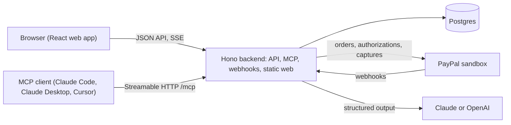

# DealingWith Agent

**Turn service requests into paid work.**

Built for the PayPal AI Hackathon (November 2026). Public repository, MIT license.

## Problem and promise

Freelancers and small service firms lose time preparing quotes and chasing payment for extras, and their clients increasingly delegate purchasing to AI assistants. Today a client's agent can buy a product from a catalog, but it cannot contract custom work whose scope and price change: "is this already included in what I paid for?" and "what does the extra cost, and why?" are unanswered.

DealingWith Agent answers them. The hero flow is the change order during a project: the client asks for something, the agent says what is already included (US$0.00), what is extra and why, with a price derived from the provider's own rules, and the client, or their agent within a pre-authorized budget, pays with PayPal. The project updates with the new scope. Humans use the web; agents use our MCP server; both operate on the same versioned quotes and payments.

## Demo

- Hosted demo: https://dealingwith-agent.onrender.com (PayPal sandbox, real model calls, real data).
- Video: `TBD: video link`
- Demo logins (no password): on the login page choose "Enter as client (Mara)" or "Enter as provider (Andes Data Studio)".
- PayPal sandbox buyer account for judges: `TBD: judge account`. This is test data, not a secret; the sandbox never moves real money.

The demo business is Andes Data Studio, a data consultancy. Its client Lukas Retail GmbH (contact Mara Keller) contracted project P1, "Retail KPI dashboard", with three scope clauses: five views including a per-branch view (included), automations, scheduled emails and alerts (excluded), one data source, Shopify (included). Mara's agent holds mandate M1: at most US$100.00 per purchase and US$300.00 in total, funded once with a PayPal authorization. On the hosted demo the mandate is already funded, and "Reset demo data" keeps that funding. If the panel ever reads "Not authorized yet", click "Authorize with PayPal" and approve with the judge account first.

## How judges test in two minutes

Sign in as Mara. The project page has a request box labelled "Describe what you need". Type the five requests below, in order, from a reset state (signed in as the provider, the header has a "Reset demo data" button).

1. "I need a per-branch view and a summary email every Monday." The quote marks the per-branch view as included at US$0.00 (clause C1) and prices the Monday summary at US$80.00 (rule `S2.report.v1`), delivery 1 day. Click "Pay with PayPal", approve on PayPal's page with the judge account, and PayPal brings you back to a receipt; the project gains clause C4 "Weekly Monday summary email". Total paid: US$80.00.
2. "Add our Amazon sales as a second source, no rush." Sent by Mara's agent over MCP, the quote comes to US$190.00 (US$150.00 base plus US$40.00 for one source). That is over the mandate's US$100.00 per-purchase limit, so the agent gets `approval_required` and an approval link for a human to pay. On the web the same quote shows "Pay with PayPal" for a human to pay. Leave it unpaid for now: paying it shifts the clause numbers below.
3. "Alert me by email when any branch's daily sales drop more than 20%." Sent by the agent, the US$60.00 alert (rule `S2.alert.v1`) is within the mandate: the agent's `accept_quote` returns `paid`, PayPal captures US$60.00 against the authorization, clause C5 is appended, and the project page updates live without a reload.
4. "Send the Monday summary to our regional managers too." Already covered by the clause paid in request 1: included at US$0.00, the button reads "Accept at no cost". The engine respects paid additionals.
5. "Make the dashboard load faster." One question back: is the slowness caused by data volume or by the dashboard design? Nothing is priced or published until it is answered.

Requests 2 and 3 can also be typed on the web; the mandate only applies when the agent pays. To run them as the agent, see the next section.

## Connect your agent

On the project page, "Connect my agent" issues a token (shown once) and prints three snippets with the host already filled in. Below, `<host>` is `dealingwith-agent.onrender.com` for the hosted demo.

Claude Code:

```text
claude mcp add --transport http dealingwith https://<host>/mcp --header "Authorization: Bearer dwa_…"
```

Cursor (`.cursor/mcp.json`):

```json
{
  "mcpServers": {
    "dealingwith": {
      "url": "https://<host>/mcp",
      "headers": { "Authorization": "Bearer dwa_…" }
    }
  }
}
```

Claude Desktop and claude.ai custom connectors cannot send headers, so they use a capability URL. Settings → Connectors → Add custom connector, paste `https://<host>/mcp/dwa_…`, choose "No sign in". Treat the URL as a secret: anyone with the link can act as your agent.

Tools: `list_services`, `list_projects`, `get_project`, `request_quote`, `answer_questions`, `get_quote`, `accept_quote`, `get_payment`, `get_mandate`. `accept_quote` spends money only within the client's mandate; otherwise it returns an approval link. The full guide, with request and response shapes, is [`docs/mcp.md`](docs/mcp.md).

## Architecture

One Node process (Hono) serves the JSON API, the MCP endpoint, the PayPal webhook and the built web app. The agent produces line-item intents; a deterministic pricing engine turns them into amounts; a policy module gates agent spending against the mandate. Details in [`docs/architecture.md`](docs/architecture.md). The hosted demo runs on Render from [`render.yaml`](render.yaml): a commit on `main` deploys only after CI passes ([`infra/README.md`](infra/README.md), [`docs/ci-cd.md`](docs/ci-cd.md)).



Design: [`docs/design/2026-11-07-dealingwith-agent-mvp-design.md`](docs/design/2026-11-07-dealingwith-agent-mvp-design.md). Plan: [`docs/plans/2026-11-07-dealingwith-agent-mvp-plan.md`](docs/plans/2026-11-07-dealingwith-agent-mvp-plan.md). Progress: [`docs/milestones.md`](docs/milestones.md). Deferred scope: [`docs/roadmap.md`](docs/roadmap.md).

## PayPal flows

- **Pay now.** Accepting a quote creates an order with intent `CAPTURE` and returns the approval link; the browser goes to PayPal's approval page (the mock approve page in mock mode), PayPal returns to `/pay/return`, and our server captures the order and shows the receipt. The same single path serves the web and the link the MCP tool hands to a human (`apps/backend/src/workflows/accept-quote.ts`, `apps/backend/src/workflows/pay-now.ts`, `apps/backend/src/workflows/capture.ts`).
- **Mandate funding.** "Authorize with PayPal" creates an order with intent `AUTHORIZE` for the funding amount; after approval we authorize it and the mandate becomes active, "Backed by PayPal authorization" (`apps/backend/src/workflows/mandate-funding.ts`).
- **Agent pays within the mandate.** The policy module checks the limits and reserves the spend under a row lock, then we capture part of the authorization with `final_capture: false`; when a limit or mandate-state check fails the agent gets an approval link instead, and a wrong project, currency or stale version is denied (`apps/backend/src/modules/policies/evaluate.ts`, `apps/backend/src/modules/policies/reserve.ts`, `apps/backend/src/workflows/accept-quote.ts`).
- **Webhooks.** Every event is signature-verified, inserted once by `paypal_event_id`, and applied idempotently; a capture confirmed by webhook before the browser returns ends in the same state (`apps/backend/src/workflows/webhooks.ts`, `apps/backend/src/api/routes/webhooks.ts`).
- **Idempotency keys.** Each payment has a unique key (`pay:<quoteId>:<version>` or `mandate:<quoteId>:<version>`) that is also the `PayPal-Request-Id` of the creating call (a renewed order appends the attempt number), so a retry or a double click never creates a second payment (`apps/backend/src/modules/payments/payments.ts`).
- **Gateway.** One interface with a mock for local work and a sandbox implementation for the hosted demo; money leaves our code only as integer cents (`apps/backend/src/integrations/paypal/`).

## Evals and tests

`pnpm test` runs 74 test files and 359 tests on an in-memory PostgreSQL (PGlite) with the mock PayPal gateway and the mock model; no credentials needed. The five scenarios in [`tests/scenarios/`](tests/scenarios/) drive the real HTTP API, pricing engine, policies and payment state machine with fixed agent outputs:

1. `01-already-included`: a request covered by a contract clause or a paid additional is included at US$0.00 and creates no payment.
2. `02-needs-info`: missing information produces a question and nothing is published.
3. `03-mcp-then-web`: a quote requested over MCP is the same quote id and version on the web.
4. `04-payment-pending`: a pending payment leaves the quote unpaid and the scope unchanged.
5. `05-duplicates`: a duplicate accept, capture or webhook yields one payment and one additional.

`pnpm eval:live` calls a real model (Anthropic or OpenAI, same prompts) on the five demo requests and grades the classification. It needs an API key and is not part of CI.

## Known limits

- Sandbox only. Live PayPal does not exist in this codebase.
- MCP authentication is a per-agent bearer token, revocable from the portal. OAuth is the production path.
- A PayPal authorization lasts 29 days, in the sandbox too (live adds a 3-day honor period). When the funding headroom falls below the per-purchase limit the mandate panel offers "Re-authorize"; an expired authorization needs the same click. Vault is the production path for standing mandates.
- Sessions are demo logins (signed cookies), not real authentication.
- One business. The data model carries `business_id` everywhere; the UI manages one provider.

## Development

```bash
pnpm install
pnpm dev        # backend with tsx watch, web with Vite
pnpm test       # vitest, all workspaces
pnpm lint       # biome
pnpm typecheck  # tsc --noEmit in every package
pnpm build      # every package to dist/
pnpm --filter @dealingwith/backend seed   # seed the demo data into DATABASE_URL
```

Open http://localhost:5173. Everything runs locally without credentials: `PAYPAL_MODE=mock`, `LLM_PROVIDER=mock` and an embedded PostgreSQL (PGlite). Copy `.env.example` to `.env` to change defaults; for the mock payment round-trip in development set `APP_URL=http://localhost:5173`, because the default `http://localhost:3000` serves only a built web (`pnpm build`). How the team works, for humans and agents: [`CONSTITUTION.md`](CONSTITUTION.md), then [`AGENTS.md`](AGENTS.md). CI gates and deployment: [`docs/ci-cd.md`](docs/ci-cd.md). Decisions: [`docs/decisions/`](docs/decisions/).

## License

MIT. See [`LICENSE`](LICENSE).
