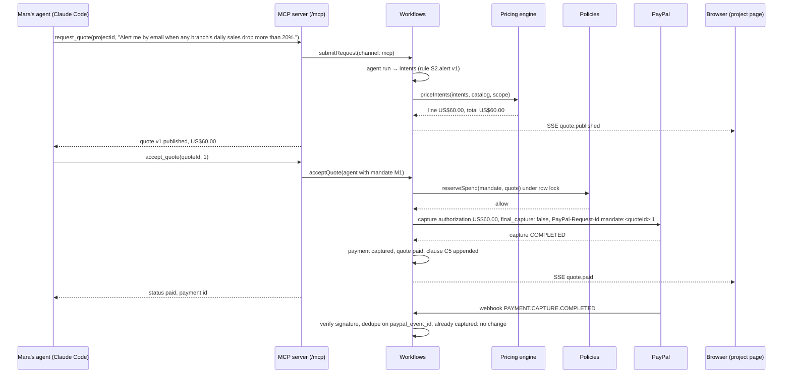

# Architecture

One page on how DealingWith Agent is built. The approved design is `docs/design/2026-11-07-dealingwith-agent-mvp-design.md`; this page describes what exists on `main`.

## One process

The deployable is a single Node 22 process (`apps/backend/src/index.ts`): a Hono app that serves the JSON API under `/api`, the MCP endpoint at `/mcp` and `/mcp/<token>`, the PayPal webhook at `/api/webhooks/paypal`, a health check at `/healthz`, and the built React app as static files. On start it loads `.env`, validates the environment, runs the migrations, seeds the demo data when `DEMO_MODE=true`, and wires one `Deps` object (database, PayPal gateway, event bus, clock, agent port, logger) that every workflow receives explicitly. With `PAYPAL_MODE=mock` the same process also serves the mock PayPal approve page under `/mock-paypal`.

## Modules (`apps/backend/src`)

- `api/` — Hono routes, one file per resource (`routes/`), Zod validation of every body and query, session and ownership guards (`auth.ts`), error mapping to stable codes and HTTP statuses, and the static server for the web build.
- `mcp/` — the MCP server: nine tools and the `quote://` resource over stateless Streamable HTTP, a fresh server per authenticated request, scopes that limit tools to the agent's client, and a Markdown formatter so every result carries text for the model and a typed `structuredContent`.
- `workflows/` — the only place with side effects across modules: `submit-request` (agent run, pricing, quote version), `accept-quote` (pay now or mandate), `pay-now` (order creation and approval link), `capture`, `mandate-funding`, `webhooks`, and the in-process event bus.
- `modules/` — pure domain logic and repositories: `quotes` (deterministic pricing engine and versioned quotes), `policies` (`evaluate` and the row-locked `reserve`), `payments`, `mandates`, `projects` (scope clauses), `requests`, `catalog`, `clients`, `dashboard`.
- `integrations/paypal/` — the `PaypalGateway` interface (create order, get order, capture order, authorize order, capture authorization, verify webhook signature), the mock implementation with its approve page and emitted webhooks, and the sandbox implementation. Cents become PayPal strings only here.
- `agent/` — the system prompt (`instructions.md`), skill files, the context pack builder, the provider switch (`anthropic`, `openai`, `mock`) on the Vercel AI SDK with structured output validated against `AgentOutputSchema`, and the run recorder. The model emits intents, never amounts.
- `access/` — signed-cookie demo sessions and per-agent tokens (hashed, revocable) with the connection snippets the portal prints.
- `db/` — Drizzle schema, migrations, the client factory (`pglite://` locally and in tests, `postgres://` on Render), the demo seed and reset.

`packages/contracts` holds the Zod schemas and money helpers shared by backend, web and MCP; the web app in `apps/web` consumes the same types, so the quote card and the MCP result are the same object.

## Data model

Eleven tables. A `request` (web or MCP, with its channel and agent) produces `quotes` versioned by the composite key `(quote_id, version)`, each naming the agent that accepted it when one did: a new version supersedes the previous one, and accept and pay always name a version, so a stale version is refused with `stale_version`. A `payment` belongs to one quote version, carries its mode (`pay_now` or `mandate`), the agent whose accept created it (empty when a person accepted on the web), the PayPal order, authorization and capture ids, and a unique `idempotency_key`. A `mandate` holds the policy limits (per purchase, total, spent, expiry) and, separately, its funding: the PayPal authorization id, amount, captured amount and expiry. `client_agents` stores hashed tokens with scopes and an optional mandate. `agent_runs` records every model call (provider, model, tokens, latency, outcome), `webhook_events` deduplicates on `paypal_event_id`, and `projects` carry their scope clauses as JSON, where a paid extra is appended as a new clause with its source quote and version.

## Two payment flows

**Pay now.** Accept creates a `pay_now` payment and a PayPal order with intent `CAPTURE` under `PayPal-Request-Id = pay:<quoteId>:<version>` (a renewed order appends the attempt number); the browser follows the approval link to PayPal (the mock approve page in mock mode); PayPal returns to `/pay/return?token=<orderId>`, which calls our capture route; the payment is `captured`, the quote `paid`, the extra lines become clauses. The webhook `PAYMENT.CAPTURE.COMPLETED` reaches the same state idempotently, whichever arrives first.

**Mandate.** The client sets limits (mandate `pending`), then assigns the budget: the limits are saved if edited, an order with intent `AUTHORIZE` for the total limit is approved and authorized, and the mandate becomes `active`. When an agent accepts a quote, `policies.reserve` checks, inside one transaction with a row lock on the mandate, that it is active and unexpired, same project and currency, that the version is the latest published, and that per-purchase, total and funding headroom all hold; then the server captures part of the authorization with `final_capture: false`. A limit or mandate-state failure returns `approval_required` with the reason and a pay-now approval link; a wrong project, currency or stale version is `denied`. A definitive PayPal decline releases the reservation; an ambiguous answer (a 5xx, a timeout, a pending capture) keeps it until the webhook settles it.

## Events and SSE

Workflows publish typed domain events (`quote.published`, `quote.needs_info`, `quote.paid`, `payment.approval_required`, `mandate.updated`) on an in-process bus. `GET /api/events?projectId=…` streams them as server-sent events, filtered to the project (clients) or the business (provider), with a heartbeat every 25 seconds. The project page subscribes on load, so a payment made by the agent appears on the client's screen without a reload.

## Demo request 3, end to end

## On Render

One web service (`0.5c-512mb`, Node 22) runs the process above and one Postgres 17 instance (`0.1c-256mb`) holds the data; the Blueprint is `render.yaml` at the repository root and `infra/README.md` has the deploy steps. Render deploys `main` only after CI passes on that commit (`autoDeployTrigger: checksPass`), and skips a commit that touches only docs, tests, CI or tooling files (`buildFilter.ignoredPaths`; see `docs/ci-cd.md`). Build: `corepack enable && pnpm install --frozen-lockfile && pnpm build`; start: the backend `start` script (`node dist/index.js`), which migrates and seeds on boot and serves the web build. Environment: `DATABASE_URL` (Render's internal URL), `PAYPAL_MODE=sandbox` with the REST app credentials and `PAYPAL_WEBHOOK_ID`, `LLM_PROVIDER` and the matching API key (`ANTHROPIC_API_KEY` also turns on the dashboard assistant; `ASSISTANT_MODEL` and `ASSISTANT_DAILY_TURN_LIMIT` are optional), `APP_URL`, `SESSION_SECRET`, `DEMO_MODE=true`, and `VITE_AG_STUDIO_LICENSE` at build time (without it the dashboard shows a watermark). The PayPal webhook is registered to `https://<host>/api/webhooks/paypal`; "Reset demo data" returns the demo mandate to `pending` with no funding, and the client funds it inside each demo run with "Assign a budget to your agent" (`docs/decisions/2026-11-12-reset-unassigns-agent-budget.md`).
